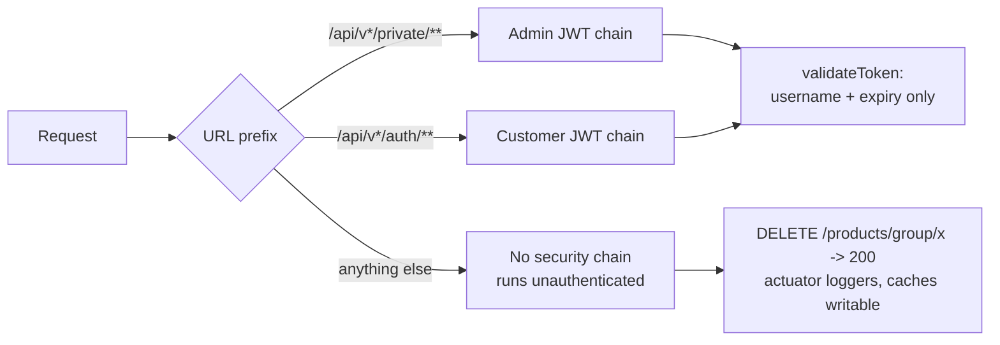
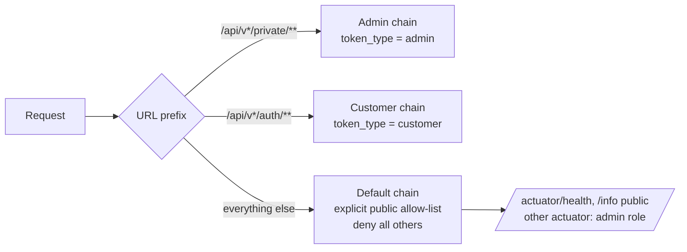
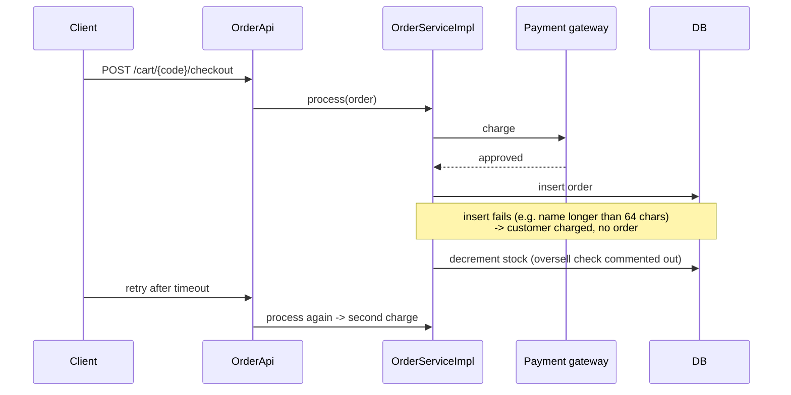
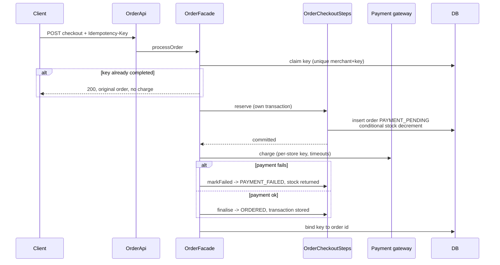
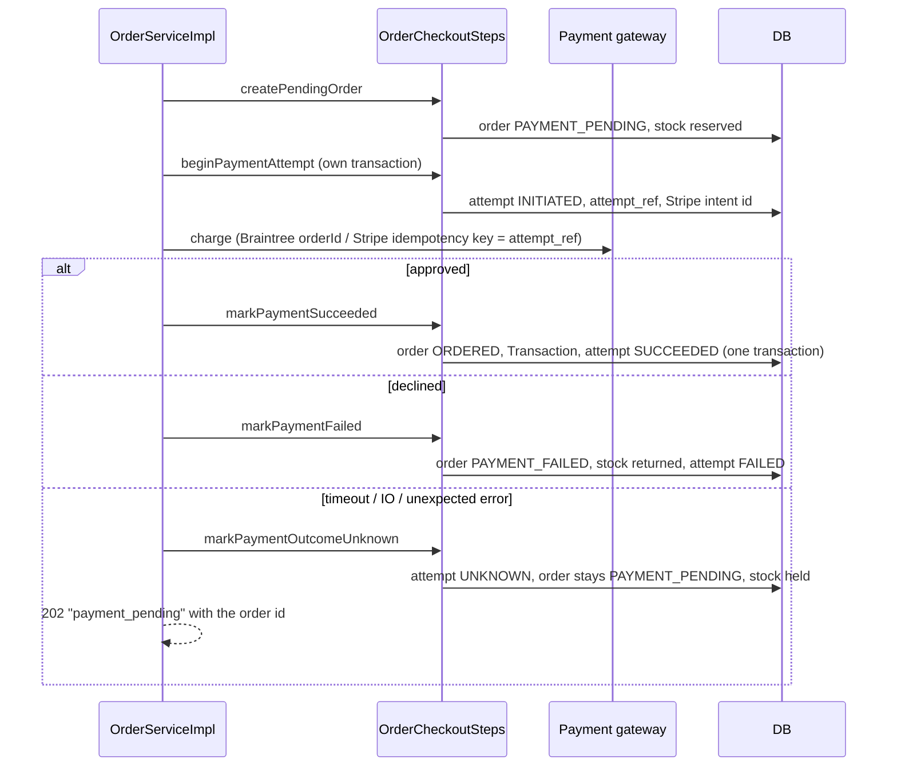
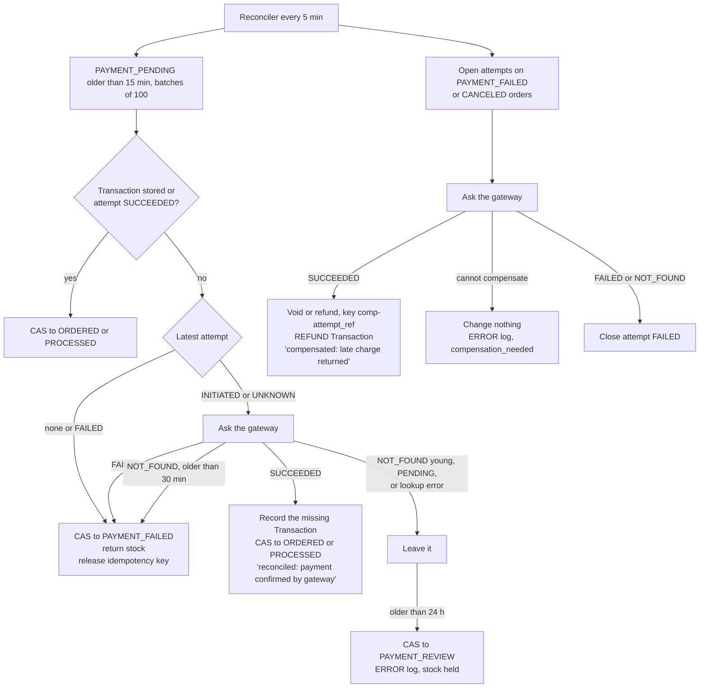
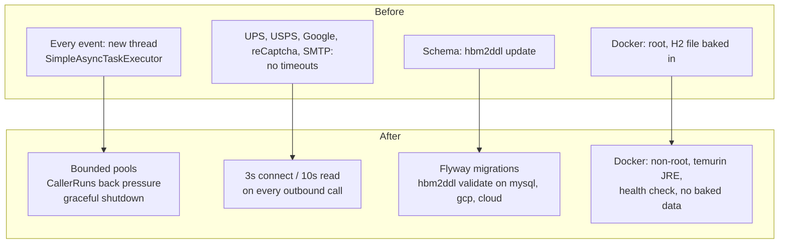

# Architecture: before and after

Shopizer keeps its shape: one Spring Boot application built from five Maven modules, with plug-in payment and shipping modules. What changes is how a request is secured, how money moves, and how the system behaves when a dependency is slow.

## 1. Request security

### Before (3.2.7)

- Admin and customer tokens were signed with the same secret (`aSecret`) and checked only for username and expiry, so a customer token with an admin's username passed the admin check.
- Any path outside the two prefixes ran with no security at all.
- Every actuator endpoint was exposed without authentication.
- CORS echoed back any Origin with credentials allowed.

### After

- Tokens carry a `token_type` claim and each chain rejects the other type.
- The signing key comes from `JWT_SECRET`; startup fails if it is shorter than 64 bytes. Tokens last 1 hour, not 7 days.
- A last, lowest-priority chain permits only listed storefront endpoints and denies the rest.
- CORS uses an allow-list (`CORS_ALLOWED_ORIGINS`).

## 2. Checkout and money

### Before

### After

- The order exists before any money moves, so every charge has an order to reconcile against.
- Stock is reserved with `UPDATE ... WHERE quantity >= :q`, so two checkouts cannot both take the last unit.
- Status changes follow an explicit transition table (`OrderStatusTransitions`); illegal moves return 409.

### Payment attempts: the gateway decides

A payment attempt is committed before every gateway call. Its reference goes to the gateway, so a charge the shop never recorded can still be found. See [ADR 0011](adr/0011-gateway-is-the-source-of-truth.md).

### Recovering stuck orders and late charges

- Each order is claimed with a compare-and-set, so two instances never settle the same order.
- Each order runs in its own transaction, so one bad order does not stop the batch.
- An order is never failed while its payment outcome is unknown and the gateway has not answered.
- Counters at `/actuator/prometheus`: `shopizer_reconciliation_orders_total{outcome=...}` with finalised, failed, skipped, error, confirmed_by_gateway, review, lookup_error, compensated, compensation_needed.

| Module | Status lookup | Compensation |
|---|---|---|
| Braintree | Search by order id = attempt_ref | Void if unsettled, refund if settled |
| Stripe (PaymentIntents) | Retrieve the intent stored before the call | Cancel if only authorised, refund if captured |
| Stripe (legacy Charges) | None: always PENDING, goes to review | None: compensation_needed |
| Money order | No gateway | None |

## 3. Payment modules

| Module | Before | After |
|---|---|---|
| Braintree | Sale without `submitForSettlement`: funds held, never settled | Sale settles; real gateway status recorded |
| Stripe | Amount built by deleting "." from "1,234.56"; key in a global static | Minor units per currency from BigDecimal; key passed per request |
| Capture / refund API | Returned 200 and did nothing | Store-scoped, amount-checked, row-locked operations recorded in the ledger |
| Braintree refund | Refund on unsettled sales failed | Void when unsettled, refund when settled |

## 4. Runtime behaviour

## What stays the same, on purpose

- **One deployable.** Five Maven modules in one jar fit a small team. Splitting it adds network failures, not features.
- **Payment and shipping module interfaces.** Per-store configuration behind a plug-in interface is the best seam in the product.
- **Per-language description tables and populators.** The gap is a missing default-language fallback, not the schema.
- **SM_SEQUENCER ids and Ehcache.** Change them when lock-wait metrics or a second instance require it.
