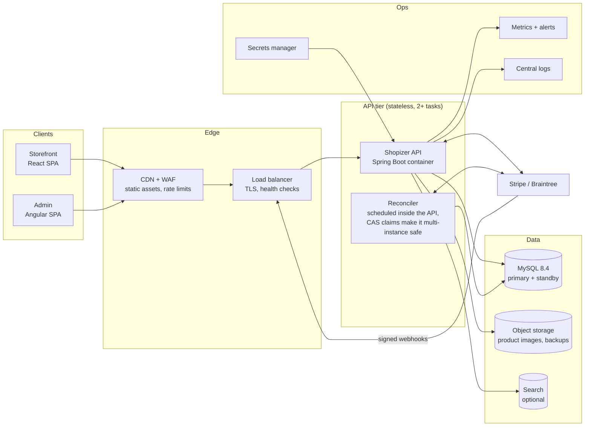

# System design: from laptop demo to production

The demo stack in `deploy/` runs the whole platform on one machine with `docker compose`. This document describes how the same containers run in production, what each choice costs, and what was deliberately left out.

## 1. Shape of the system

**Principles**

- **Stateless API.** Sessions are JWTs, files live in object storage, and the reconciler claims work with compare-and-set. Any task can be killed or added at any time.
- **The database is the only stateful tier.** It is managed, replicated and backed up. It is never shared with another application.
- **The gateway is the source of truth for money.** See [ADR 0011](adr/0011-gateway-is-the-source-of-truth.md).
- **One deployable.** The modular monolith stays. See [ADR 0001](adr/0001-keep-the-modular-monolith.md).

## 2. Local demo and production, side by side

| Concern | Local demo (`deploy/docker-compose.yml`) | Production target (AWS) |
|---|---|---|
| API | 1 container, health check, graceful stop | ECS Fargate, 2+ tasks across 2 AZs, rolling deploys with health-gated rollback |
| Edge | Ports on localhost | CloudFront + WAF for the SPAs, ALB with TLS for the API |
| Database | MySQL 8.4 container, named volume, binary log on | RDS MySQL 8.4 Multi-AZ, encrypted, private subnets only |
| Backups | `backup` container: consistent dump every 6 hours, 14 kept, checksummed | RDS automated backups with 7-35 day point-in-time restore, plus a daily snapshot copied to a second region |
| Restore proof | `deploy/backup/restore-drill.sh` restores into a scratch server and compares row counts | Same drill, monthly and before every schema migration, restoring a snapshot into a scratch instance |
| Schema | Flyway V1-V4, Hibernate `validate` | Same. Migrations run once per deploy, before the new tasks take traffic |
| Secrets | `deploy/.env`, git-ignored | Secrets Manager, injected into the task. Rotation for the DB password |
| Metrics | Prometheus + Grafana, provisioned dashboard and alert rules | Same rules, through a metrics sidecar on localhost or Amazon Managed Prometheus |
| Logs | Docker json logs, rotated | CloudWatch Logs, 30-day retention, structured JSON |
| Files | Named volume | S3 with versioning, served through CloudFront |
| Frontends | nginx containers | Static builds on CloudFront or Vercel |

## 3. Data: durability, backups and recovery

| Target | Demo | Production |
|---|---|---|
| RPO (data you can lose) | Up to 6 hours from dumps. Minutes with the binary log | About 5 minutes, from RDS point-in-time restore |
| RTO (time to recover) | Minutes. Restore the newest dump | Under 1 hour for a restore. Under 2 minutes for a Multi-AZ failover |
| Region loss | Not covered | Snapshot copy to a second region. RTO a few hours, which is acceptable at this scale |

**Rules I would hold the team to**

- **A backup that has not been restored is not a backup.** The restore drill is scheduled, and its result is a metric.
- **Migrations go forward only.** A destructive change ships in two releases: first stop using the column, then drop it.
- **Every migration on a production-sized copy first.** Restore last night's snapshot, run the migration and time it, before it touches production.
- **The payment ledger is append-only.** Refunds add rows and never edit the order total. Retention follows the payment provider's dispute window, usually 18 months or more.

## 4. Scaling to 200 merchants

- **The API scales out.** Each task is stateless. Two tasks of 1 vCPU and 2 GB handle the demo load with room to spare (see [PERFORMANCE.md](PERFORMANCE.md)). Add tasks on CPU above 60% or p95 latency above 500 ms.
- **Reads go to caches and replicas before the primary.** Catalog reads are about 90% of traffic. A read replica and HTTP caching at the CDN absorb them. Checkout and admin writes stay on the primary.
- **Noisy tenants are isolated by rate limits first, and by sharding only if needed.** One merchant's flash sale must not slow the others. WAF rate rules per store come first. A separate database for a very large merchant comes later, and the store-scoped queries make that possible.
- **Background work is bounded.** Event and async pools are bounded, and the reconciler runs in batches of 100 with a cap per run.

## 5. Postgres: why later, not now

| | MySQL 8.4 (now) | PostgreSQL 17 (planned) |
|---|---|---|
| Code risk | None. Proven with Flyway V1-V4 and the demo | Needs its own baseline, dialect fixes and a parallel test run |
| Tenant isolation | Every query must filter by store | Row-level security can enforce the store filter in the database |
| Search and recommendations | Needs OpenSearch | `pg_trgm` for small catalogs, `pgvector` for recommendations |
| Concurrency | Good. `SKIP LOCKED` is available since 8.0. Gap locks under REPEATABLE READ can surprise | MVCC without gap locks. `SKIP LOCKED` as well, so neither engine wins on queues |
| Managed options | RDS MySQL | RDS Postgres, Aurora Serverless v2 (scales to zero), or Supabase |

**Decision:** stay on MySQL for this release and plan Postgres as its own project. Changing the hosting and the database in the same release doubles the blast radius of every incident. The migration plan has five steps:

1. Generate a Postgres baseline from the same JPA mapping.
2. Run the full suite and the end-to-end demo against both databases in CI.
3. Copy data with a verified row-count and checksum comparison.
4. Cut over in a maintenance window with a tested rollback, which is the last MySQL snapshot.
5. Turn on row-level security per store.

**On Supabase's free tier:** it is good for a $0 demo, but it has no automated backups and pauses after 7 idle days. Using it for real data needs the Pro plan or our own nightly dump to S3 with a restore drill.

## 6. Cost of the production target (ap-southeast-2, on-demand, monthly)

| Item | Size | Approx. cost |
|---|---|---|
| ECS Fargate API | 2 tasks of 1 vCPU / 2 GB | $70 |
| Application Load Balancer | 1 | $20 |
| RDS MySQL Multi-AZ | db.t4g.small, 50 GB gp3 | $65 |
| CloudFront, S3, CloudWatch, Secrets Manager | Light use | $15 |
| **Total** | | **about $170** |

A single-AZ, single-task variant for a pilot costs about $45 a month. The local demo costs nothing. That is why the demo runs locally. Running production infrastructure for an interview, with no customer on it, would be spending without a reason.

## 7. What I would add next, in order

1. **Infrastructure as code** for the AWS target, in Terraform or CDK, reviewed in pull requests.
2. **An outbox table for domain events.** Order placed and refund issued go to a queue, so search indexing and email never run inside the checkout transaction.
3. **Settlement reconciliation.** Compare daily gateway payout reports with the ledger, and alert on any difference.
4. **SLOs with error budgets.** Checkout success at 99.9% and p95 under 800 ms, owned by the team and reviewed weekly.
